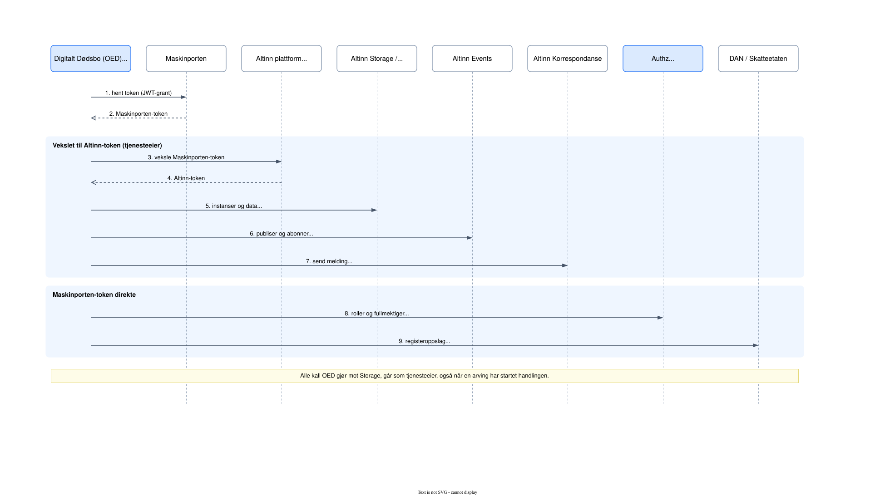
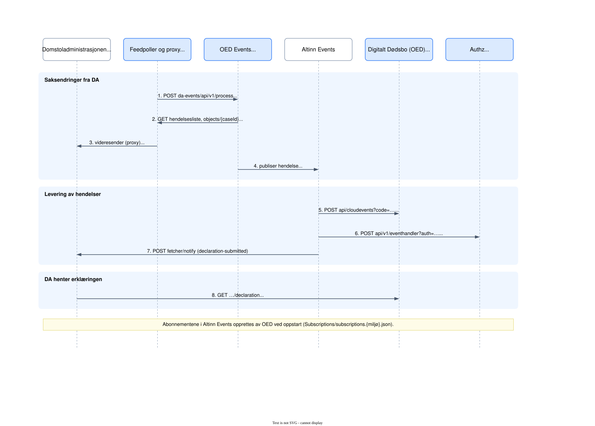

# Autentisering og tokens

Hvem kaller hvem, og med hvilket token. Scopes er hentet fra koden.

## OED som tjenesteeier

<picture>
  <source media="(prefers-color-scheme: dark)" srcset="autentisering-tjenesteeier-dark.svg">
  <source media="(prefers-color-scheme: light)" srcset="autentisering-tjenesteeier-light.svg">
  
</picture>

## Hendelser og integrasjon med DA

<picture>
  <source media="(prefers-color-scheme: dark)" srcset="autentisering-hendelser-dark.svg">
  <source media="(prefers-color-scheme: light)" srcset="autentisering-hendelser-light.svg">
  
</picture>
