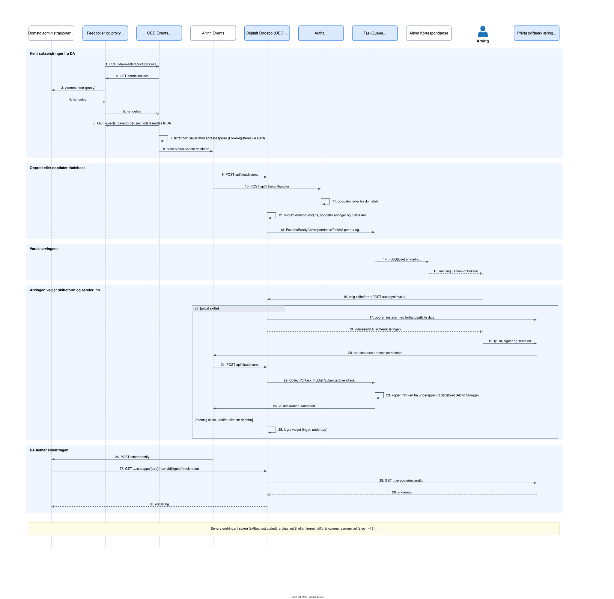

# Livsløp for et dødsbo

Fra Domstoladministrasjonen (DA) registrerer en sak, til DA henter skifteerklæringen. Diagrammet viser privat skifte
(dd-private-probate), som er V2-løpet. OED Events leser DA sin hendelsesliste gjennom proxyen i oed-feedpoller.

<picture>
  <source media="(prefers-color-scheme: dark)" srcset="livslop-dark.svg">
  <source media="(prefers-color-scheme: light)" srcset="livslop-light.svg">
  
</picture>

**Eldre løp (oed-declaration).** Skifteformer appen ikke kjenner igjen, går til oed-declaration. Ved innsending
sender den `app.instance.process.completed` til OED (`POST api/cloudevents/declaration`), og OED publiserer
`v1.declaration-submitted` direkte, uten TaskQueue. DA henter erklæringen fra `GET api/declarations/{partyId}/{instanceId}`.

**Avslutning.**
- Feilført eller kansellert sak: ventende «Dødsboet er klart»-oppgaver avbrytes, og oed-authz fjerner alle roller.
- Avdøde lever likevel (Folkeregisteret): dødsboet trekkes tilbake, og det sendes ingen meldinger.
- Skifteattest utstedt: melding til arvingene, arkivering, og skifteform kan ikke lenger velges.
