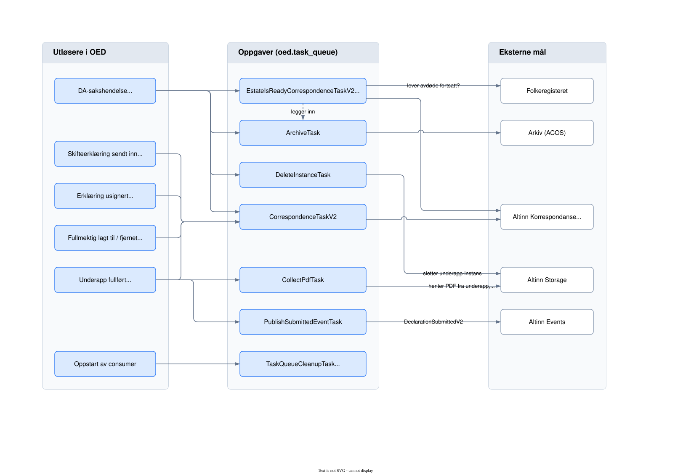
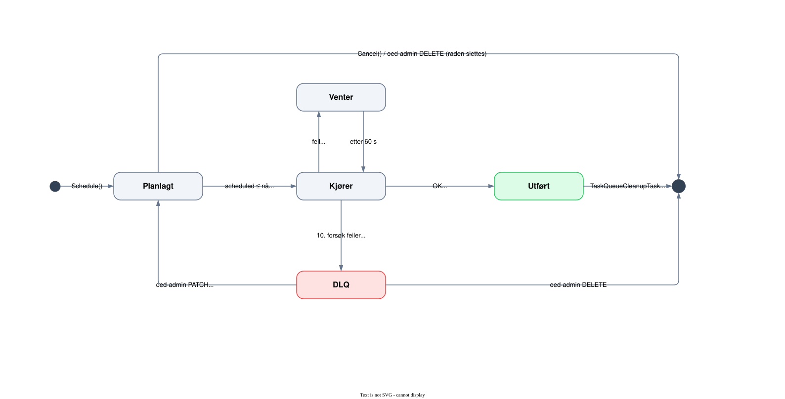

# TaskQueue

Bakgrunnsjobber i OED-appen (digdir/oed) lagres i tabellen `oed.task_queue` i PostgreSQL og kjøres av
`TaskQueueConsumerService`. En oppgave legges i køen i samme transaksjon som endringen som utløste den,
så en rullet tilbake endring etterlater ingen oppgave.

## Hvem legger inn hva, og hva oppgaven gjør

<picture>
  <source media="(prefers-color-scheme: dark)" srcset="taskqueue-oppgaver-dark.svg">
  <source media="(prefers-color-scheme: light)" srcset="taskqueue-oppgaver-light.svg">
  
</picture>

| Oppgave | Legges inn av | Gjør |
|---|---|---|
| `CorrespondenceTaskV2` | DA-sakshendelse (ProbateIssued, ProbateChanged, ProbateHeirAdded/Removed m.fl.), innsendt og usignert erklæring, fullført underapp, fullmektig lagt til/fjernet | Sender melding via Altinn Korrespondanse på arvingens språk (nb/nn). 409 regnes som sendt. |
| `EstateIsReadyCorrespondenceTaskV2` | DA-sakshendelse, planlagt til tilgangsdato kl. 05:00 UTC + 0–120 min | Sjekker Folkeregisteret først; lever avdøde, trekkes dødsboet tilbake uten utsending. Ellers legges `ArchiveTask` inn og meldingen sendes. |
| `ArchiveTask` | `EstateIsReadyCorrespondenceTaskV2`, skifteattest utstedt | Lager zip og hash og sender til arkiv (ACOS). |
| `CollectPdfTask` | Fullført underapp | Kopierer underappens PDF til dødsbo-instansen. |
| `PublishSubmittedEventTask` | Fullført underapp | Publiserer `DeclarationSubmittedV2` til Altinn Events. |
| `DeleteInstanceTask` | DA-sakshendelse der arving mister fullmakt | Sletter underapp-instansen. |
| `TaskQueueCleanupTask` | Oppstart, og seg selv | Sletter utførte rader eldre enn 90 dager og planlegger seg selv 24 timer frem. |

## Livsløp for en rad

<picture>
  <source media="(prefers-color-scheme: dark)" srcset="taskqueue-livslop-dark.svg">
  <source media="(prefers-color-scheme: light)" srcset="taskqueue-livslop-light.svg">
  
</picture>

- Én oppgave kjøres om gangen per pod. Flere pods deler køen via `FOR UPDATE SKIP LOCKED`.
- Køen pollar hvert 60. sekund når den er tom. Feilede oppgaver prøves på nytt etter fast 60 sekunder (ingen backoff), maks 10 forsøk.
- Feiler en oppgave, rulles handlerens egne databaseendringer tilbake (savepoint), også oppfølgingsoppgaver den la inn.
- Det finnes ingen egen DLQ-tabell. En rad med `executed` og `scheduled` lik `null` er død, og blir liggende til den slettes eller planlegges på nytt i oed-admin.
- Køen har ingen dedup-nøkkel. Idempotens sikres av flagg på arvingen i `OED_M` og idempotensnøkkelen i korrespondanse-biblioteket.
- Avbryt aldri en oppgave fra en handler: `Cancel()` sletter også raden som kjører, og den kjøres da på nytt i det uendelige.
